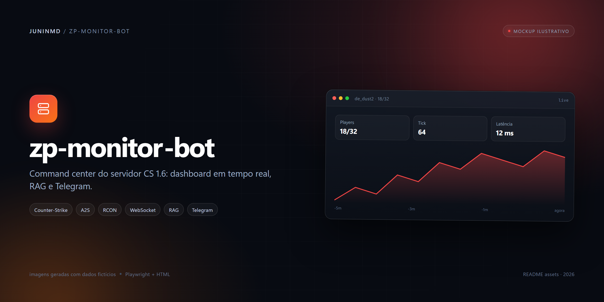
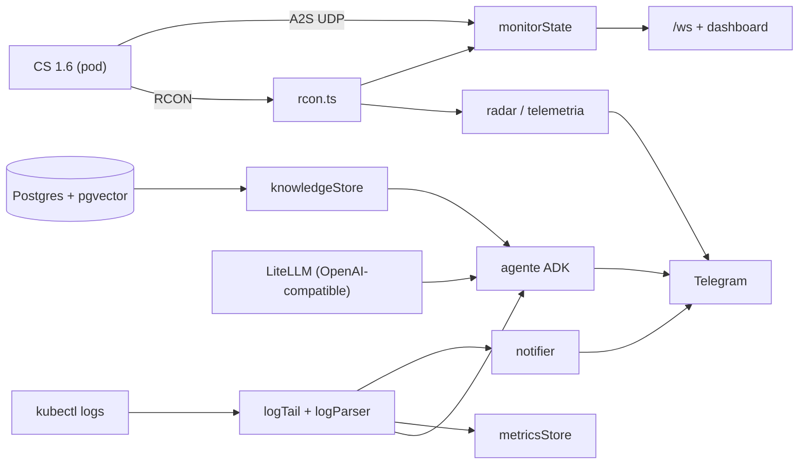
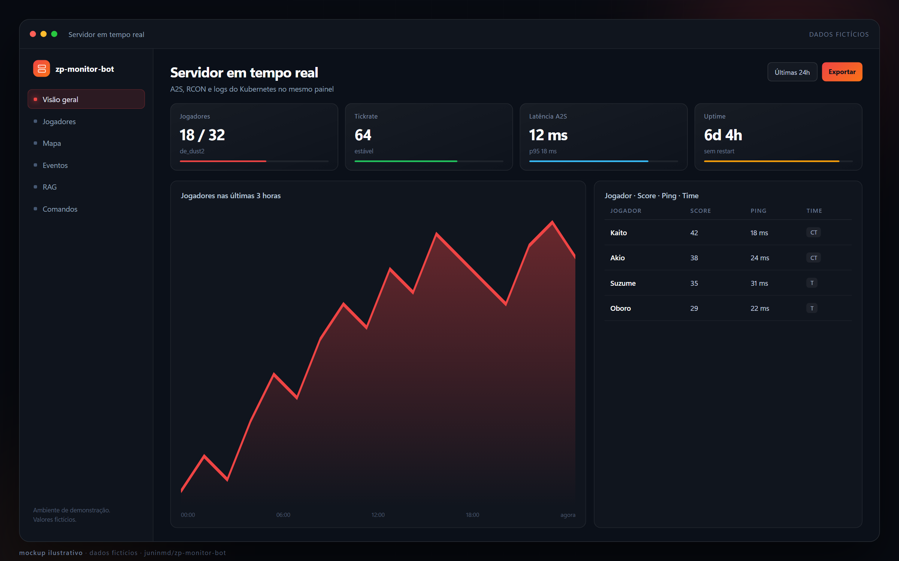
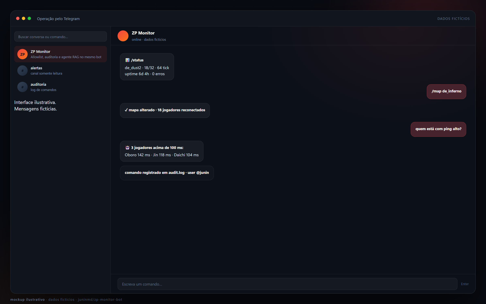

# zp-monitor-bot

<p align="center">
  
</p>

Command center do servidor de Counter-Strike 1.6 Zombie Plague: monitora o servidor por A2S e RCON, serve um dashboard em tempo real por WebSocket, responde perguntas com um agente Google ADK sobre uma base RAG em pgvector e opera o servidor pelo Telegram com allowlist e auditoria.

O bot foi feito para um servidor específico (`server-do-junin`) e assume que o servidor CS roda em Kubernetes, com os logs acessíveis por `kubectl logs` e os arquivos do mapa por `kubectl exec`. Fora desse ambiente ele funciona em modo degradado — as seções de arquitetura e limitações dizem exatamente o que cai.

## Segurança em primeiro lugar

Esta é a parte do projeto que mais importa, porque o bot tem RCON e um LLM no mesmo processo.

- **Chat allowlist.** O polling do Telegram compara o `chat.id` com `TELEGRAM_CHAT_ID`. Qualquer outro chat é recusado e gera um evento `security`/`denied` em `audit_events`; a mensagem não é respondida.
- **Token de entrada.** `POST /api/telegram` exige `Authorization: Bearer <TELEGRAM_BOT_TOKEN>` e compara os bytes com `crypto.timingSafeEqual`. Sem isso, o endpoint responde `401`.
- **Allowlist de RCON.** O parser aceita apenas `/rcon status|stats|users|zp_telemetry_snapshot` e `/map <nome>`. Não existe caminho para texto livre virar comando de console.
- **Nome de mapa é token, não string.** `/map` e a tool `change_map` reduzem o nome a `[a-zA-Z0-9_-]` e exigem 3–32 caracteres antes de montar `changelevel`.
- **Ferramentas presas ao remetente.** As tools de jogo usam o nome do próprio jogador que falou (aspas, quebras de linha e `;` removidos), nunca um alvo escolhido pelo modelo. A quantidade de Ammo Packs é limitada por `AGENT_AMMO_MAX_AMOUNT` (padrão 30) e cada tool tem cooldown.
- **Texto de jogador e de LLM não é comando.** Respostas do agente passam por `sanitizeChatReply` antes de virarem `amx_csay`; o conteúdo recuperado do RAG entra no prompt marcado como dado não confiável, com instrução explícita para não seguir comandos embutidos.
- **Auditoria.** Perguntas, respostas, comandos, saídas de RCON e tentativas negadas são gravados em `audit_events` com `action` (`question`, `command`, `security`, `knowledge`), `status` (`started`, `success`, `denied`, `failed`), ator, chat, request, response e metadata. Sem banco, a auditoria fica desligada — e isso é uma limitação operacional, não um modo recomendado.
- **A tool de escrita só existe no caminho do administrador.** `store_zombie_knowledge` é adicionada somente ao agente de perguntas do Telegram (`answerZombieQuestion`), não às tools do chat do jogo. Cada gravação audita antes e depois, e só devolve sucesso após o embed e o upsert no pgvector.
- **Segredos** vêm de `.env` local ou Kubernetes Secret. O Dockerfile copia `src`, `public` e `knowledge`; não há token no repositório nem na imagem.
- **O que ainda é aberto:** o dashboard (`/`), `/stats`, `/api/state`, `/api/today` e o WebSocket `/ws` não têm autenticação. Trate o serviço como interno e não publique a porta 8091 na internet.

## O que ele faz

| Área | Comportamento |
|---|---|
| Monitor A2S | Consulta o servidor com `gamedig` a cada `POLL_INTERVAL_MS` (3 s por padrão): nome, mapa, jogadores, bots, ping e histórico em memória (reidratado de `presence_samples` no boot) |
| Separação humano/bot | Usa a tabela do RCON `status` (capturando também o `SteamID`); se ela estiver velha ou indisponível, cai numa heurística e sinaliza isso no dashboard e no `/status` |
| RCON | Consulta periódica para FPS do servidor e telemetria do plugin Zombie Plague (`zp_telemetry_snapshot`, `zp_telemetry_positions` sob demanda quando há clientes WS) com parser resiliente a respostas truncadas |
| Dashboard | `public/index.html` (**ZP Command Center 2.0**) servido em `/`, com WebSocket: mapa, radar tático e heatmap de kills em `<canvas>`, jogadores reais, inspetor de jogador (Steam + Trust Score + rivalidades), ping, FPS, zumbis × humanos, gráfico de atividade, eventos ZP, auditoria, card MVP PNG e ranking |
| Métricas e Heatmap | Kills (com coordenadas 3D `x, y, z` do mapa), mortes, pico de humanos, jogadores distintos, linhas de chat, top fraggers, rivalidades e armas; limpeza automática após `RETENTION_DAYS` |
| Radar e Heatmap PNG | Desenha posição/direção dos jogadores e mapas de calor de abates sobre o overview do mapa (ou grade tática auto-escalável) |
| Card Visual MVP | Gera relatório PNG (`1200×675`) com KPIs do dia, avatar do MVP, armas letais e Top 5 fraggers (`/resumo` ou `/api/summary.png`) |
| Log tail | Acompanha `kubectl logs` do container do servidor, parseia conexão, desconexão, chat, kills (com coordenadas) e troca de mapa, e alimenta notificações, Game Master, métricas e agente |
| Game Master & Comandos | Narra kill streaks (5/10/15) e modos especiais ZP no HUD (`amx_csay`) com cooldown global; comandos rápidos determinísticos `!stats`, `!rank`, `!rival`, `!rtv <mapa>` e `!comandos` respondem sem gastar LLM |
| Trust Score silencioso | Avalia VAC/game bans, horas de CS, trocas de nick, ReUnion e picos de kills/min no inspetor e alerta o Telegram apenas em `high_risk` |
| Agente no jogo e RAG | Jogador fala `!ia`, `!bot` ou `!admin` e o agente responde com contexto vivo do servidor e busca RAG (pgvector + sincronização viva de `zp_*.ini` e `mapcycle.txt` do pod), sempre com auditoria e cooldown |
| Telegram | Comandos com botões inline interativos (`/status`, `/stats`, `/ranking`, `/radar`, `/mapa`, `/heatmap`, `/resumo`, `/rag`, `/sync`, `/audit`, `/rcon`, `/map`, `/ask`); notificações de entrada/saída, chat e troca de mapa |
| Rotação de mapa | Se o servidor ficar sem humanos por `MAP_ROTATION_EMPTY_MINUTES` num mapa fora da lista de populares, troca via `changelevel` priorizando retenção histórica (`presence_samples`) ou progressão circular |

## Comandos do Telegram

O parser (`src/telegramCommands.ts`) aceita exatamente:

| Comando | Aliases | O que faz |
|---|---|---|
| `/help` | `/start` | Lista os comandos |
| `/status` | `/players` | Servidor, mapa, jogadores e telemetria (com botões rápidos inline) |
| `/stats` | `/metrics` | Métricas do dia: kills, mortes, pico, distintos, chat, top fraggers e armas |
| `/ranking` | `/top` | Ranking de 7 dias e recorde de pico |
| `/radar` | — | PNG com posição e direção |
| `/mapa` | `/print`, `/screenshot` | Print do mapa atual |
| `/heatmap` | `/calor` | Mapa de calor (PNG) das kills no mapa atual |
| `/resumo` | `/card`, `/mvp` | Card visual PNG (1200×675) com KPIs e MVP do dia |
| `/rag` | `/conhecimento` | Fontes e chunks indexados no pgvector |
| `/sync` | `/sync-rag` | Re-sincroniza `zp_*.ini` e `mapcycle.txt` do pod no RAG |
| `/ask <pergunta>` | texto livre (2–1000 caracteres) | Pergunta ao agente com contexto do pgvector e estado vivo |
| `/rcon status\|stats\|users\|zp_telemetry_snapshot` | — | Console remoto auditado |
| `/map <nome>` | — | `changelevel` auditado, nome com 3–32 caracteres `[a-z0-9_-]` |
| `/audit` | — | Últimas ações registradas |

Qualquer outra coisa que comece com `/` cai em `unknown` e devolve a ajuda. No chat do jogo, os comandos rápidos `!comandos`, `!stats`, `!rank`, `!rival` e `!rtv <mapa>` respondem diretamente via HUD; o gatilho padrão da IA é `!ia`, `!bot`, `!admin` ou a palavra `bot` (`AGENT_TRIGGER_REGEX`).

## Endpoints

| Método | Rota | Resposta |
|---|---|---|
| `GET` | `/` | Dashboard HTML (**ZP Command Center 2.0**) |
| `GET` | `/health` | `200` quando o bootstrap terminou e o banco responde; `503` caso contrário. Inclui revisão (`GIT_SHA`), uptime, chunks ingeridos, sync do pod e totais do pgvector |
| `GET` | `/metrics` | Métricas no formato Prometheus (`text/plain; version=0.0.4`) |
| `GET` | `/stats` | Estado resumido do monitor |
| `GET` | `/api/state` | Estado completo (mesmo payload do WebSocket, incluindo `radar`) |
| `GET` | `/api/today` | Jogadores do dia, ranking de 7 dias, recorde de pico, métricas diárias e votos `!rtv` |
| `GET` | `/api/audit` | Últimos 20 eventos de auditoria |
| `GET` | `/api/rag` | Estatísticas e fontes indexadas no RAG |
| `GET` | `/api/player/:steamId` | Perfil Steam, resumo de K/D, rivalidades e Trust Score silencioso |
| `GET` | `/api/map/meta/:map` | Calibração de overview e pontos do heatmap do mapa |
| `GET` | `/api/map/image/:map` | PNG base limpo (chroma-key aplicado) do overview do mapa |
| `GET` | `/api/map/heatmap/:map/image.png` | PNG do mapa de calor de kills do mapa |
| `GET` | `/api/summary.png` | Card visual PNG (1200×675) de resumo diário e MVP |
| `POST` | `/api/telegram` | `{ "text": "...", "chatId"?: "...", "actor"?: "..." }`, autenticado por Bearer; devolve `{ "reply": "..." }` |
| `WS` | `/ws` | Assina o canal `state` e recebe `{ "type": "state", "data": ... }` |

O servidor escuta em `0.0.0.0:8091` (`PORT`).

## Como funciona



| Arquivo | Papel |
|---|---|
| `src/index.ts` | Elysia: rotas, WebSocket, Prometheus, bootstrap e shutdown gracioso |
| `src/config.ts` | Lê e valida as variáveis de ambiente no import |
| `src/monitorState.ts` | Polling A2S, RCON, radar, histórico e estado publicado |
| `src/goldsrcRcon.ts`, `src/rcon.ts` | Protocolo RCON do GoldSrc e parsers tolerantes a resposta truncada |
| `src/logTail.ts`, `src/logParser.ts` | Stream de logs do pod e parser de eventos (inclui coords 3D em kills) |
| `src/notifier.ts`, `src/playerAnnounce.ts` | Notificações e perfil/visitas de jogador |
| `src/gameMaster.ts`, `src/inGameCommands.ts` | Narração de streaks/modos ZP e comandos rápidos (`!stats`, `!rival`, `!rtv`) |
| `src/trustScore.ts`, `src/steamSignals.ts` | Índice de confiança silencioso e alerta Telegram em `high_risk` |
| `src/metrics.ts`, `src/metricsStore.ts`, `src/metricsQueries.ts` | Métricas em memória, buffer de kills com coords, heatmap e consultas |
| `src/agent/*` | ADK, tools com cooldown/auditoria, sessões, cliente LiteLLM e RAG |
| `src/knowledge.ts`, `src/knowledgeStore.ts`, `src/podKnowledge.ts`, `src/embeddings.ts` | Chunking, ingestão de docs e configs do pod, e busca vetorial |
| `src/database.ts` | Tabelas `knowledge_chunks`, `audit_events`, `player_sessions`, retenção e `auditEvent()` |
| `src/telegram.ts`, `src/telegramBot.ts`, `src/telegramCommands.ts` | Envio, botões inline, polling, allowlist e parser de comandos |
| `src/mapImage.ts`, `src/radar.ts`, `src/summaryCard.ts`, `src/podFiles.ts` | Print do overview, heatmap PNG, radar e Card MVP PNG |
| `src/prometheus.ts` | Exportador de métricas `/metrics` |

No boot o processo cria as tabelas, reidrata as métricas do dia, ingere `knowledge/*.md` e só então marca `ready`. Um restart no meio da noite não pode reportar “0 kills hoje” com o servidor cheio. O `/health` só fica verde depois disso.

## Como rodar

Pré-requisito: [Bun](https://bun.sh) 1.3.13 (a mesma versão do CI e da imagem). Não há dependência de Node.

```bash
bun install --frozen-lockfile
cp .env.example .env
# edite TELEGRAM_BOT_TOKEN e TELEGRAM_CHAT_ID; o resto é opcional
bun run dev
```

O Bun carrega o `.env` sozinho. `TELEGRAM_BOT_TOKEN` e `TELEGRAM_CHAT_ID` são obrigatórios: `src/config.ts` lança `Missing env var` no import sem eles.

O database precisa existir e já ter a extensão `vector` habilitada; o código cria as tabelas, mas não a extensão. Sem `DATABASE_URL`, o serviço sobe com RAG e auditoria desligados e `/health` responde `503`. Sem `RCON_PASSWORD`, o monitor fica só no A2S e a separação humano/bot vira heurística.

Para o caminho completo (notificações, radar, print), o processo precisa de `kubectl` no PATH, de um kubeconfig com acesso a pods/logs/exec no namespace configurado e do plugin `zp50_telemetry` no servidor.

### Docker

```bash
docker build -t zp-monitor-bot:local .
docker run --rm -p 8091:8091 --env-file .env zp-monitor-bot:local
```

A imagem roda como usuário `bun` e expõe `8091`. Ela **não inclui `kubectl`**: o log tail e o print do mapa não funcionam no container padrão; o radar gerado localmente continua disponível.

## Variáveis de ambiente

Obrigatórias:

| Variável | Para que serve |
|---|---|
| `TELEGRAM_BOT_TOKEN` | Token do bot; também é o Bearer esperado em `POST /api/telegram` |
| `TELEGRAM_CHAT_ID` | Único chat autorizado a comandar o bot |

Opcionais (padrão entre parênteses):

| Variável | Padrão | Efeito |
|---|---|---|
| `DATABASE_URL` | vazio | Postgres com pgvector; sem ela, RAG/auditoria off e `/health` 503 |
| `RCON_PASSWORD` | vazio | Habilita RCON; sem ela, sem FPS/telemetria e split heurístico |
| `SERVER_HOST` | `cs16-server-udp.server-do-junin.svc.cluster.local` | Host do servidor para A2S e RCON |
| `SERVER_PORT` | `27015` | Porta do servidor |
| `PORT` | `8091` | Porta HTTP |
| `POLL_INTERVAL_MS` | `3000` | Intervalo do A2S |
| `RCON_INTERVAL_MS` | `5000` | Intervalo do RCON |
| `RCON_TIMEOUT_MS` | `3000` | Timeout do RCON |
| `HISTORY_LENGTH` | `720` | Amostras mantidas no histórico |
| `K8S_NAMESPACE` | `server-do-junin` | Namespace dos pods |
| `K8S_POD_SELECTOR` | `app=cs16-server` | Seletor do pod do servidor |
| `K8S_CONTAINER` | `cs16-server` | Container lido pelo log tail |
| `LOG_TAIL_ENABLED` | `true` | Liga o tail de logs |
| `TELEGRAM_POLLING_ENABLED` | `true` | Liga o `getUpdates` deste processo |
| `STEAM_API_KEY` | vazio | Foto/perfil oficial da Steam; sem ela, tenta o perfil público XML |
| `CHAT_RELAY_BOTS` | `false` | Repassa falas de bots para o Telegram |
| `KNOWLEDGE_DIR` | `./knowledge` | Diretório ingerido no boot |
| `AGENT_ENABLED` | `true` | Liga o agente |
| `LITELLM_API_KEY` | vazio | Sem ela, o agente não responde |
| `LITELLM_BASE_URL` | `http://litellm.ai.svc.cluster.local:4000/v1` | Gateway OpenAI-compatible |
| `AGENT_MODELS` | `cloud/auto` | Lista separada por vírgula; usa o primeiro que responder e fixa o que funcionou |
| `EMBEDDING_MODEL` | `nomic-embed-text` | Modelo de embedding do RAG |
| `AGENT_TRIGGER_REGEX` | `^!(ia\|bot\|admin)\b\|\bbot\b` | Gatilho no chat do jogo |
| `AGENT_SESSION_TTL_MIN` | `20` | TTL da sessão do jogador |
| `AGENT_AMMO_COOLDOWN_MIN` | `5` | Cooldown de AP por jogador |
| `AGENT_AMMO_MAX_AMOUNT` | `30` | Teto de AP por pedido |
| `AGENT_RESPAWN_COOLDOWN_MIN` | `2` | Cooldown de respawn/unstick |
| `AGENT_MAP_CHANGE_COOLDOWN_MIN` | `10` | Cooldown global de troca de mapa |
| `MAP_ROTATION_ENABLED` | `true` | Liga a rotação de mapa vazio |
| `MAP_ROTATION_EMPTY_MINUTES` | `15` | Tempo sem humanos para disparar |
| `MAP_ROTATION_COOLDOWN_MINUTES` | `60` | Intervalo mínimo entre rotações |
| `MAP_ROTATION_POPULAR_MAPS` | vazio | Mapas que nunca são trocados automaticamente |
| `MAP_ROTATION_CANDIDATE_MAPS` | vazio | Lista de destinos possíveis |
| `RETENTION_DAYS` | `90` | Retenção em dias para `audit_events`, `kill_events` e `presence_samples` |
| `GAME_MASTER_ENABLED` | `true` | Liga narração de kill streaks e modos especiais no HUD |
| `GAME_MASTER_COOLDOWN_MIN` | `3` | Cooldown global entre anúncios do Game Master |
| `RTV_ENABLED` | `true` | Habilita votação `!rtv <mapa>` no chat do jogo |
| `RTV_COOLDOWN_MIN` | `10` | Cooldown global entre trocas via RTV |
| `TRUST_ALERT_ENABLED` | `true` | Envia alerta no Telegram quando um jogador `high_risk` (VAC/game ban) entra |
| `POD_KNOWLEDGE_ENABLED` | `true` | Sincroniza `zp_*.ini` e `mapcycle.txt` do pod no pgvector |

O `.env.example` traz valores de exemplo do cluster (inclusive `AGENT_MODELS` com modelos específicos); troque-os pelo seu ambiente.

## Desenvolvimento e testes

```bash
bun run lint        # biome check
bun run typecheck   # tsc --noEmit
bun test            # bun test
bun run build       # bun build para dist/
bun run smoke       # smoke de ponta a ponta (banco, Telegram, RAG, RCON e agente)
```

`bun test` importa `config.ts` transitivamente, então precisa das variáveis obrigatórias. Localmente o `.env` resolve; no CI são valores fake e nenhum teste faz chamada de rede (`TELEGRAM_BOT_TOKEN`, `TELEGRAM_CHAT_ID`, `LITELLM_API_KEY`, `RCON_PASSWORD`).

`bun run smoke` é diferente: ele exige banco com pgvector, RCON e token reais, grava um fato via `store_zombie_knowledge`, confere a recuperação no pgvector, consulta o agente e envia uma mensagem de verdade ao `TELEGRAM_CHAT_ID`. Não rode contra produção sem querer.

Workflows reais do repositório:

| Workflow | Conteúdo |
|---|---|
| `ci.yml` | `bun install --frozen-lockfile`, lint, typecheck, `bun test` com env fake e build |
| `validate.yml` | Workflow reutilizável `reusable-validate.yml` de `juninmd/base-actions` em PRs e pushes |
| `docker.yml` | Build e push da imagem pelo `reusable-docker-build.yml`, com `image-name` do repositório |
| `security.yml` | Scan de segurança pelo workflow compartilhado, em push e semanalmente (`cron 0 0 * * 0`) |

## Imagens

> [!NOTE]
> **Mockups ilustrativos.** As telas abaixo foram geradas em HTML com dados fictícios (Playwright) e não são capturas de uma instalação real.

<p align="center">
  
  <br>
  <sub>Servidor em tempo real — dados fictícios.</sub>
</p>

<p align="center">
  
  <br>
  <sub>Operação pelo Telegram — dados fictícios.</sub>
</p>


## Limitações

- **Uma instância.** O estado do monitor e o histórico vivem em memória; duas réplicas fariam duas consultas A2S e dois pollings do Telegram. Escale verticalmente, não horizontalmente.
- **Leitura sem autenticação.** `/`, `/ws`, `/api/state`, `/api/today` e `/stats` são abertos. O Bearer protege apenas `POST /api/telegram`.
- **Dependência de `kubectl`.** A imagem não o instala. Sem ele, não há log tail nem print do overview; o radar local continua.
- **Print do mapa depende do servidor.** Precisa de `overviews/<mapa>.txt` e do bitmap no pod, além de calibração para sobrepor posições. Sem isso, degrada para o radar.
- **Telegram: um consumidor por token.** Em produção o `megabrain` é descrito como o único consumidor de `getUpdates`, encaminhando ao endpoint interno autenticado; nesse arranjo, suba este serviço com `TELEGRAM_POLLING_ENABLED=false` para não disputar updates. Com o polling ligado, este processo é o consumidor.
- **Sem banco, sem auditoria.** `DATABASE_URL` ausente deixa RAG e `audit_events` desligados, e o `/health` em 503. Não é um modo de produção.
- **A2S não separa bots.** A contagem confiável vem do RCON `status`; a heurística é um palpite e aparece marcada como tal.
- **O agente não é determinístico.** Depende de um gateway LiteLLM compatível com OpenAI e de um modelo que respeite o formato esperado; a lista `AGENT_MODELS` existe para cair para o próximo quando um falha.
- **Não há benchmark publicado.** O repositório não declara CPU, memória ou latência; meça no seu cluster.
- **Sem arquivo de licença.** Não há `LICENSE` no repositório.
